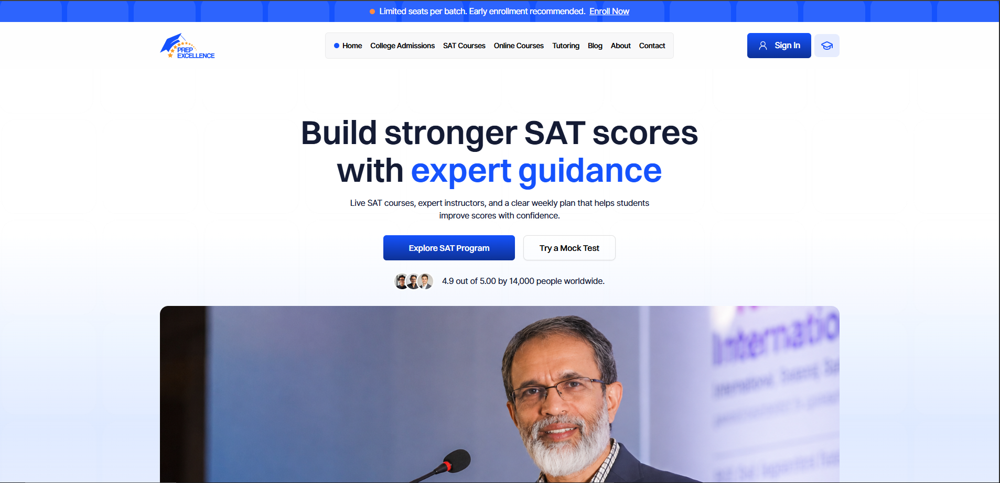

# Prep Excellence — SAT Preparation Platform

  

  <strong>Learn with structure. Prepare with confidence. Achieve your goals.</strong>

  <a href="https://prepexcellence.com/">Live Website</a>
  &nbsp;•&nbsp;
  <a href="https://github.com/Shazed94/prep-excellence">GitHub Repository</a>

---

## Overview

**Prep Excellence** is an educational platform focused on helping students prepare for the SAT through structured learning programs, expert instruction, and guided practice.

The platform provides students with access to different preparation options, including group classes, intensive courses, online learning, and personalized tutoring.

Its goal is to make test preparation more organized, accessible, and focused on measurable academic progress.

## Key Features

- **Structured SAT Preparation:** Organized learning programs designed around students' preparation goals.
- **Online Courses:** Access to online learning opportunities and educational resources.
- **Group Classes:** Collaborative learning with structured sessions and guided practice.
- **Intensive Programs:** Focused preparation for students working toward specific exam dates.
- **One-to-One Tutoring:** Personalized learning support based on individual needs.
- **Expert Instructors:** Access to experienced educators and subject specialists.
- **Student Support:** Consultation and guidance for students and parents.
- **Responsive Interface:** A user-friendly experience across desktop, tablet, and mobile devices.

## Technology Stack

The project uses modern web technologies to deliver a responsive and maintainable application.

| Category | Technologies |
| --- | --- |
| Frontend | React, TypeScript |
| Build Tool | Vite |
| Routing | TanStack Router |
| Styling & UI | Tailwind CSS, Radix UI |
| State Management | Zustand |
| Forms & Validation | React Hook Form, Zod |
| Backend | Node.js, Express.js |
| Database & ORM | PostgreSQL, Prisma |
| Testing | Vitest |
| Workspace Tooling | Nx, pnpm |

_The technologies listed represent selected tools used in the project. Internal infrastructure and proprietary implementation details are intentionally omitted._

## Why These Technologies?

- **React and TypeScript:** Build reusable UI components with a more predictable and maintainable codebase.
- **Vite:** Provide a fast development experience and optimized frontend builds.
- **TanStack Router:** Manage application navigation with a structured routing approach.
- **Tailwind CSS and Radix UI:** Create consistent, responsive interfaces using reusable styling and accessible UI primitives.
- **Zustand:** Manage application state without unnecessary complexity.
- **React Hook Form and Zod:** Handle forms and maintain consistent input validation.
- **Node.js and Express.js:** Support server-side application functionality and API development.
- **PostgreSQL and Prisma:** Work with structured relational data through a type-safe database access layer.
- **Nx and pnpm:** Support organized development across multiple applications and shared code.

## Development Challenges & Solutions

Building an educational platform involves more than presenting course information. It requires a consistent experience across different learning journeys and user needs.

Some of the key engineering challenges include:

- **Organizing complex user journeys:** Creating clear navigation between courses, tutoring options, and other educational resources.
- **Maintaining UI consistency:** Building reusable interface patterns to support a consistent experience across the platform.
- **Responsive design:** Ensuring the application remains usable across different screen sizes.
- **Form handling and validation:** Providing reliable input handling for interactive application workflows.
- **Application maintainability:** Using TypeScript and reusable components to make ongoing development easier.
- **Data-driven functionality:** Connecting frontend experiences with backend services and structured application data.

## My Contributions

As part of the development team at **TRODAD International Ltd.**, I contributed to the development of this company project.

My experience involved working with modern frontend and full-stack technologies, building application features, integrating services, and collaborating on the development of a production-oriented educational platform.

The exact scope of my individual contributions is intentionally summarized to respect company confidentiality.

## Dependencies

The application uses a collection of libraries and tools for:

- UI development and component composition
- Application routing and state management
- Form management and schema validation
- API and database integration
- Testing, formatting, and development workflows

The complete dependency manifests and internal development setup are not published as part of this portfolio presentation.

## Local Development

This is a proprietary company project. The complete source code, backend services, configuration, and development environment are not distributed through this public portfolio repository.

Therefore, a standalone local installation guide is not provided.

You can explore the publicly available application through the live website:

**[Visit Prep Excellence](https://prepexcellence.com/)**

## Project Links

- **Live Website:** [https://prepexcellence.com/](https://prepexcellence.com/)
- **GitHub Repository:** [https://github.com/Shazed94/prep-excellence](https://github.com/Shazed94/prep-excellence)

---

  <strong>Prep Excellence</strong> 
  Structured learning. Expert guidance. Better preparation.

  Company project developed at TRODAD International Ltd. All rights reserved by the respective owner.

